# Animal Detection on Streets: a YOLOv8 detector and surveillance website for dogs, goats, cows, cats and sheep

> **Course report and code repository.** A fine-tuned YOLOv8 object detector finds five kinds of animals (dog, goat, cow, cat, sheep) in
> photos, videos and live camera feeds. A Flask website around it separates people from animals, keeps a **timestamped log** of every
> sighting, tracks individual animals across frames, draws **zones** on the road and raises **lost-animal alerts** when a tracked
> animal has not been seen for a set time.

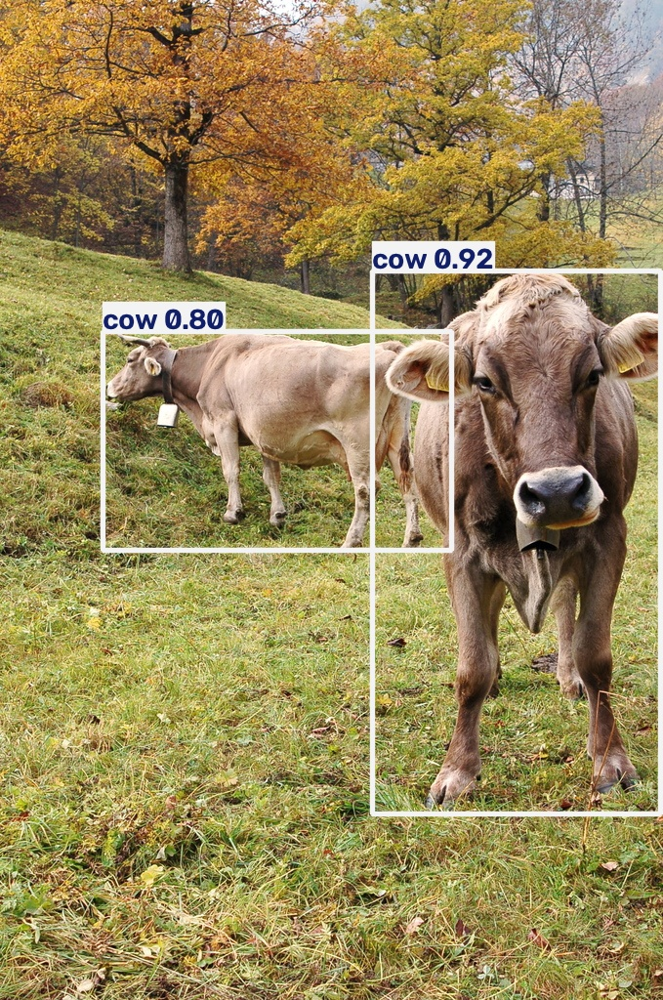

## Abstract

Stray and free-roaming animals on streets are a safety problem for drivers, pedestrians and for the animals themselves. This project
asks a narrow, testable question: *can a small, fast object detector be fine-tuned to recognise the animals seen on streets in Nepal
(dog, goat, cow, cat, sheep), and can it drive a simple CCTV-style monitoring website?* We fine-tuned YOLOv8s with its first 10 layers frozen
(`freeze=10`) on 2,993 training images assembled from Open Images V7 and two Mendeley Data sets, and compared it with two pretrained baselines
(COCO `yolov8n`, Open Images `yolov8m-oiv7`). On the frozen 80-image test set the final model reaches **mAP50 0.842** (mAP50-95 0.589), against
0.810 for the COCO baseline and 0.906 for the Open Images baseline; the latter is probably inflated because it was pretrained on Open Images,
the source of our test photos. Freezing the backbone was the single change that mattered most: it lifted validation mAP50 from 0.66 to 0.79 on the
first data version by reducing overfitting. **The test data are not Nepal street photos**, so the numbers show that the pipeline works, not
how accurate it is in Nepal; collecting and labelling local photos is the main future work.

## Table of contents

1. [Quick start](#1-quick-start)
2. [Background](#2-background)
3. [Methodology](#3-methodology)
   - [3.1 Pipeline](#31-pipeline-overview) · [3.2 Object detection and YOLOv8](#32-object-detection-and-yolov8) · [3.3 Metrics](#33-metrics-explained)
   - [3.4 Transfer learning and freezing](#34-transfer-learning-and-layer-freezing) · [3.5 Datasets](#35-datasets) · [3.6 Training setup](#36-training-setup)
   - [3.7 Evaluation protocol and baselines](#37-evaluation-protocol-and-baselines)
4. [Results and analysis](#4-results-and-analysis)
5. [The surveillance website](#5-the-surveillance-website)
6. [Ethics, limitations, future work](#6-ethics-limitations-and-future-work)
7. [Reproducing everything](#7-reproducing-everything)
8. [Repository layout](#8-repository-layout)
9. [Licence and credits](#9-licence-and-credits)
10. [References](#10-references)

---

## 1. Quick start

You need Python **3.11**, about 3 GB of disk and (optional) an NVIDIA GPU. Run everything from the repo root.

### 1.1 Create an environment

```bash
git clone https://github.com/Suchit-Aryal/Animal-Detector.git
cd Animal-Detector

# Option A: conda (Linux / macOS / Windows)
conda create -n animal-det python=3.11 -y
conda activate animal-det

# Option B: venv
python3.11 -m venv .venv
source .venv/bin/activate           # Linux / macOS
.venv\Scripts\activate              # Windows (cmd or PowerShell)
```

### 1.2 Install the packages

PyTorch depends on your hardware. Install it **first**, picking your CUDA version (or CPU) on <https://pytorch.org/get-started/locally/>:

```bash
pip install torch torchvision --index-url https://download.pytorch.org/whl/cpu      # CPU only
# for an NVIDIA GPU choose the cu12x line that matches your driver instead
pip install -r requirements.txt
```

`requirements.txt` lists only direct dependencies. `requirements-lock.txt` is the complete frozen environment of the original Linux + CUDA
machine, kept for reference (it will not install elsewhere as it is). Without the PyTorch step, `ultralytics` pulls a default PyTorch (a large CUDA build on Linux).

### 1.3 Run the model on an image or video

The final weights `results/weights/best.pt` (22 MB) are tracked in git, so no dataset is needed for this.

```bash
python src/demo.py --source path/to/street.jpg      # writes results/figures/<name>_annotated.jpg
python src/demo.py --source path/to/street.mp4      # writes an annotated .mp4
python src/demo.py --source 0 --max-frames 300      # webcam
# --device cpu if you have no GPU, --conf 0.4 for fewer and surer boxes
```

### 1.4 Run the website

```bash
python web/app.py
```

Open <http://127.0.0.1:5055/> (it listens on your own computer only). The first start downloads `yolov8n.pt` (the person detector).
Install `ffmpeg` (optional) so uploaded videos play in the browser. Full user guide: [`web/README.md`](web/README.md).

### 1.5 Run the notebooks

```bash
python -m ipykernel install --user --name animal-det --display-name "Python (animal-det)"
jupyter lab
```

Open the notebooks in `notebooks/` with the **animal-det** kernel. Each runs a fast demo by default (about 10 images, or 1 epoch); set
`FULL_RUN = True` in its parameter cell for the real run. Order and contents: [`notebooks/README.md`](notebooks/README.md).

| Notebook | Content |
|---|---|
| `00_data_pipeline` | class ids, label format, spot checks, group split, counts, sources |
| `01_baseline_evaluation` | COCO and Open Images baselines on the test images |
| `02_train_model` | fine-tuning with `freeze=10`, learning curves |
| `03_evaluate_and_compare` | metrics, comparison table, per-class chart, confusion matrix, failure cases |
| `04_demo_inference` | detection on an image and a video |
| `05_web_app_guide` | how the website works, person rule demo, log queries |

---

## 2. Background

### 2.1 The problem

Cows, goats, dogs and other animals share the road with people and vehicles. In the Terai region of Nepal cows and goats are a common sight on
roads (our project plan, `PROJECT_PLAN.md` section 2, names them as the animals actually seen on Nepali streets). For drivers this means collision
risk; for the animals, injury and loss; for owners of livestock, animals that wander off and cannot be found again. Municipal or private
CCTV cameras already cover many roads and farms, but nobody can watch every feed. Software that turns a video stream into a searchable log of
"what animal, where, when" can answer questions such as *Which road do cows cross most at dusk?* or *Has the goat that was in the yard this
morning left?*

### 2.2 Objectives

1. Detect five animal classes (ids fixed everywhere: `0 dog, 1 goat, 2 cow, 3 cat, 4 sheep`) with boxes, class and confidence.
2. Measure honestly how much fine-tuning improves on pretrained detectors, with the same test images and code for every model.
3. Wrap the detector in a usable website: upload or live camera, people kept apart from animals, a timestamped log, per-animal tracking,
   zones and "animal not seen for N minutes" alerts.
4. Keep everything reproducible: fixed seeds, scripts and CSVs behind every number, notebooks that rerun the key steps.

### 2.3 Scope

In scope: object detection (boxes), five classes, offline evaluation on held-out images, a local single-user website. Out of scope: segmentation,
identifying a *specific* animal, species other than the five, deployment on phones or embedded devices, behaviour analysis. Sheep is an optional
fifth class (decision of 15 Nov 2026) added mainly so that the model learns to tell goats from sheep.

### 2.4 Why computer vision and object detection

A classifier answers "is there an animal in this photo?"; a street scene usually has several animals of different kinds at different positions.
An **object detector** returns a box, a class and a confidence for each, which is what a log, a zone check ("is the cow on the road?") and a
tracker all need. Modern one-stage detectors such as YOLO run in real time on modest hardware (about 100 images per second for our model on a
laptop GPU, Section 4), which is what live camera monitoring requires.

### 2.5 Related work

Resources named in `PROJECT_PLAN.md` section 4 and surveyed in `results/web_research.md` (ideas only; **no code was copied**):

| Work | What it does | What we took as an idea |
|---|---|---|
| Ultralytics YOLOv8 | detector, trainer, evaluator, ByteTrack integration | used as an installed package |
| Frigate NVR (MIT) | self-hosted camera system with local object detection | live dashboard, zones, event list |
| Viseron (MIT), ZoneMinder (GPL-2.0) | self-hosted NVR / classic CCTV | event list per camera |
| FlyingFathead/dvr-yolov8-detection | YOLOv8 human/animal DVR with Flask UI | snapshot gallery, live preview |
| gotogrub/OpenCV-Animal-Detector | YOLOv8 wildlife zones with SQLite log | polygon zones filtered by species, SQLite log |
| CodeforNepal/wild-watch | Nepal wildlife-near-settlement detection with a siren/webhook output | local context; physical alert output (not built) |
| Scientific Reports 2024: YOLO architectures for road-killed Brazilian animals | compares YOLO versions, augmentation and transfer learning on 1,458 images / 5 species | motivation for comparing model sizes and transfer learning |
| IJTech: cow crossing detection alert system | YOLO with a custom cow data set, very high mAP50 on its own data | warns that our numbers will not match theirs |

Our own survey found no repository that combines animal detection, Flask, SQLite and a snapshot gallery, which is the gap this website fills.

---

## 3. Methodology

### 3.1 Pipeline overview

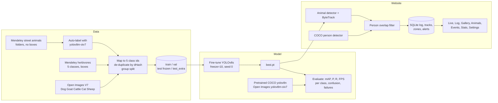

### 3.2 Object detection and YOLOv8

**Task.** Given an image, output a list of boxes `(x1, y1, x2, y2)`, each with a class and a confidence between 0 and 1.

**YOLO ("you only look once")** predicts all boxes in a single forward pass of one network, instead of proposing regions and classifying them
in a second stage. Ultralytics YOLOv8 [Jocher et al.] has three parts:

- **Backbone** (layers 0-9 in the YOLOv8 configuration): a convolutional feature extractor built from `C2f` blocks (cross-stage-partial blocks with extra
  skip connections) and ending in an SPPF layer (spatial pyramid pooling, fast). It turns the image into feature maps at three scales (strides 8, 16, 32).
  Early layers detect edges and textures; deeper layers detect parts and shapes.
- **Neck** (a PAN/FPN-style feature pyramid): mixes the three scales top-down and bottom-up, so small animals (fine scale) get semantic information
  and large animals (coarse scale) get spatial detail.
- **Head** (decoupled and **anchor-free**): for every cell of each scale, separate small branches predict the class scores and the box, with no
  pre-defined anchor boxes. The box is predicted as four distances to the cell as distributions over discrete bins.

**Loss.** Training minimises a weighted sum of three terms (default gains in our run: `box 7.5`, `cls 0.5`, `dfl 1.5`, from `runs/detect/v2A_s_freeze10/args.yaml`):

| Term | What it penalises |
|---|---|
| box loss (CIoU [Zheng et al.]) | poor overlap, centre distance and aspect-ratio mismatch between predicted and true box |
| cls loss (binary cross-entropy) | wrong class scores |
| DFL (distribution focal loss [Li et al.]) | a box-edge distribution that is not sharp around the true edge position |

Which predictions count as positives is decided by a task-aligned assigner that ranks candidates by both class score and IoU [Feng et al.].

**Non-maximum suppression (NMS).** Many cells predict the same animal. NMS keeps the highest-scoring box and removes other boxes of the same class whose
IoU with it exceeds a threshold (0.7 in our validation runs).

**Model sizes.** YOLOv8 comes in sizes that trade accuracy for speed. Parameter counts below are the published Ultralytics figures; the speed is
our measurement (RTX 4050 laptop GPU, `model.predict` per image, Section 4.3).

| Size | Parameters (published) | Layers fine-tuned here | Measured FPS |
|---|---|---|---|
| `yolov8n` (nano) | 3.2 M | all | 116 |
| `yolov8s` (small) | 11.2 M | all, or all but the first 10 | 99 (all) / 78 (freeze=10, v1 run) |
| `yolov8m` (medium) | 25.9 M | all | 56 |

(FPS varies by 20 or more between runs on a shared laptop GPU: the same `yolov8s freeze=10` model measured 78 in one session and 98 in another.)

### 3.3 Metrics explained

- **IoU (intersection over union)** of two boxes = area of overlap / area of union. 1 is a perfect match.
- A prediction is a **true positive** if its class is right and its IoU with an unmatched true box is at least a threshold (0.5 for mAP50). Otherwise it is a
  **false positive**; a true box with no matching prediction is a **false negative** (a *miss*).
- **Precision** = TP / (TP + FP): of the boxes the model drew, how many were right. **Recall** = TP / (TP + FN): of the animals present, how many it found.
- **AP (average precision)** for one class: lower the confidence threshold from high to low, record the precision-recall curve, take the area under it.
  **AP50** uses IoU 0.5. **mAP50** is the mean over classes. **mAP50-95** averages mAP over IoU thresholds 0.50, 0.55, ..., 0.95, so it rewards tight boxes
  and is always lower.
- A class with **no test boxes** (sheep in the frozen test set) has no AP: we report `NaN` / "not evaluated" and exclude it from means. Classes a model cannot
  predict (goat in COCO) are also `NaN`, not 0, so they do not drag the mean down.
- **FPS** = 1 / mean seconds per image of `model.predict` (read, preprocess, inference, NMS), batch of one.

### 3.4 Transfer learning and layer freezing

Training a detector from random weights needs far more data than we have. **Transfer learning** starts from a model pretrained on a large data set
(COCO, 80 classes, about 118k images) and continues training on ours, so the low-level features (edges, fur textures, legs) do not have to be learned again [Yosinski et al.].

**Freezing** means the first N layers keep their pretrained weights and are not updated. `freeze=10` freezes layers 0-9, the whole backbone, and trains only the neck and the head.
The reason is **overfitting**: with about 3,000 images the unfrozen model memorises the training pictures. The evidence is the gap between training and validation class loss
(experiment table in Section 4.1; plot below):

| Run (v1 data) | Train class loss | Validation class loss |
|---|---|---|
| yolov8n, all layers | 0.52 | 1.53 |
| yolov8s, all layers | 0.36 | 1.50 |
| yolov8m, all layers | 0.39 | 1.43 |
| yolov8s, **freeze=10** | 0.30 | **1.09** |

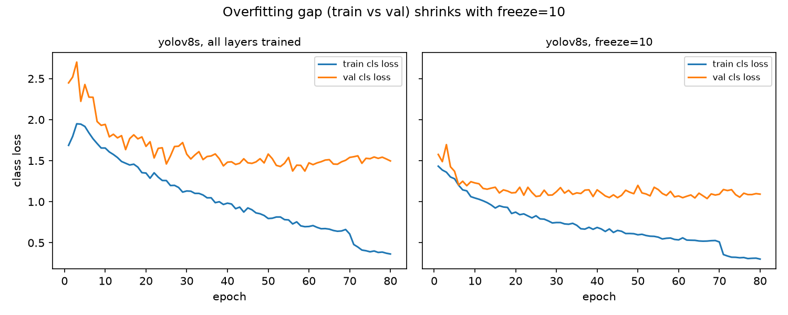

With all layers trainable the validation class loss stays high (1.4-1.5) while the training loss falls to 0.36-0.52. With the backbone frozen the validation loss
stays lower. We chose `freeze=10` because it had the best **validation** mAP50 (0.792 against 0.60-0.66), never because of the test score.
The model still overfits somewhat (v2: train 0.38 vs validation 1.02).

### 3.5 Datasets

Class ids are fixed everywhere: `0 dog, 1 goat, 2 cow (Open Images "Cattle"), 3 cat, 4 sheep`. Every source, licence and count is in [`data/SOURCES.md`](data/SOURCES.md).
**No images are stored in this repository.**

| Source | Licence | Boxes | Role |
|---|---|---|---|
| Open Images V7 (Dog, Goat, Cattle, Cat; 798 images) | annotations CC BY 4.0, images CC BY 2.0 | human-drawn | v1: split 70/20/10 into train/val/test by image |
| Open Images V7, goat/sheep subset (524 images, 503 kept) | same | human-drawn; "group-of" boxes removed using `IsGroupOf` | v2: train/val plus the 80 images of `test_extra` |
| Mendeley "Annotated Object Detection Dataset of Five Herbivorous Animal Classes" (DOI 10.17632/fwm6z9tv3f.1) | CC BY 4.0 | as published (Roboflow export) | train and val only (2,127 of 3,062 images kept) |
| Mendeley "Labelled dataset of animal images for detecting their presence on streets" (DOI 10.17632/fk29shm2kn.1) | CC BY 4.0 | **none**: images sorted into class folders, boxes auto-generated by us | train only (689 images after 2 rejects) |
| Roboflow Universe sets (stray dogs, goats, cattle, stray cats) | per page | login required | not used so far (listed in `data/SOURCES.md`) |

**Mapping.** Mendeley herbivores: Buffalo to cow, Cow to cow, Goat to goat, Sheep to sheep, Camel images dropped. Each source has an explicit mapping; an unmapped
class is skipped, never guessed (`src/data/roboflow_mapping.json`, `data/label_map.md`).

**Auto-labelling.** The Mendeley street-animal images have no boxes, only a class folder. `data/mendeley_autolabel.py` runs a pretrained Open Images YOLO
(`yolov8m-oiv7.pt`), keeps the detection that matches the folder's class and writes it as the box. These boxes are **model-generated**, so they are used for training
only and never for validation or testing. In v1, 55% of the training images came from this source; a 30-image visual spot check rejected 2 (a box on a tower, a missing box).

**Duplicates.** Roboflow-style exports contain augmented copies of one source image. For the v2 Mendeley data we kept one image per source and removed near-duplicates with a
**perceptual hash** (dHash, Hamming distance 4 or less, `imagehash` library), then capped each class at 600 images. 21 Open Images goat/sheep images that were already in the v1 set were left out.

**Splits and leakage.** Splits are made by *group*, never by frame: all frames of one video or scene go to the same split (`src/data/split_dataset.py`, `data/dataset/split_manifest.csv`).
Open Images photos are each their own group. The merge script checks that no source appears in two splits. The 80-image **test** split is **frozen**: it was never changed
after v1 (checked byte for byte) and never used to choose a model. We chose models on the validation split only. A second held-out set **test_extra**
(80 Open Images goat and sheep photos) was added in v2 to evaluate sheep, which the frozen test set does not contain.

| Split (v2) | images | dog | goat | cow | cat | sheep |
|---|---|---|---|---|---|---|
| train | 2,993 | 337 | 1,109 | 1,808 | 467 | 1,066 |
| val | 634 | 52 | 300 | 318 | 55 | 222 |
| test (frozen) | 80 | 33 | 22 | 41 | 22 | 0 |
| test_extra | 80 | 4 | 108 | 70 | 0 | 116 |

(v1 had train 1,247 / val 160 / test 80 images, with only 19 sheep boxes in train and none in val or test.) Counts from `data/SOURCES.md`.

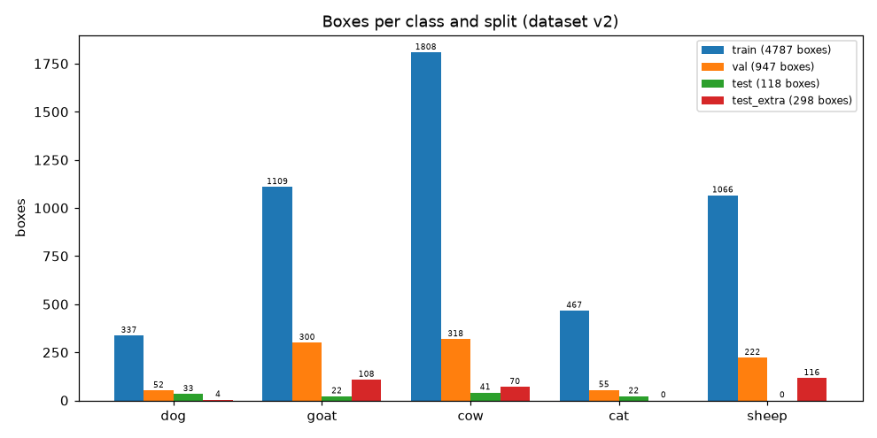

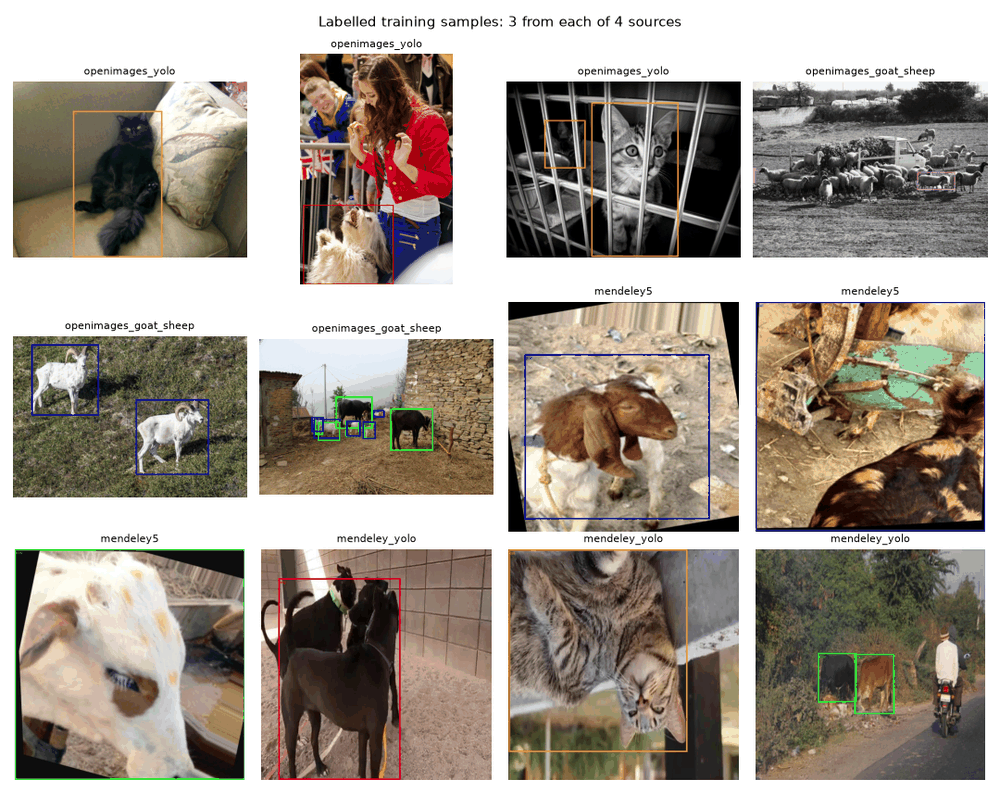

**The whole-frame box question.** 2,761 of the 8,598 Mendeley boxes cover at least 98% of the frame in both directions. Many are close-ups where the animal really fills the photo,
but some are wrong. We trained two variants: **A** keeps all images; **B** (`data_nowf.yaml`, `src/data/make_nowf_list.py`) drops every Mendeley train image that has such a box (661 images, leaving 2,332),
removing whole images so an unlabeled animal is never turned into background. Results in Section 4.2.

### 3.6 Training setup

| Item | Value |
|---|---|
| Framework | Ultralytics 8.4.213, PyTorch 2.15 (CUDA), Python 3.11 |
| Hardware | one NVIDIA RTX 4050 Laptop GPU (6 GB) |
| Start weights | `yolov8s.pt` (COCO pretrained) |
| Freeze | first 10 layers (the backbone) |
| Epochs / patience | 80 maximum / stop after 20 epochs without validation improvement |
| Batch / image size / workers | 8 / 640 / 2 |
| Seed | 0, `deterministic=True` |
| Optimiser, learning rate | `optimizer=auto` (chosen by Ultralytics), `lr0 0.01`, `lrf 0.01`, momentum 0.937, weight decay 0.0005, 3 warm-up epochs |
| Augmentation (Ultralytics defaults) | mosaic 1.0 (switched off for the last 10 epochs), horizontal flip 0.5, scale 0.5, translate 0.1, HSV jitter (h 0.015, s 0.7, v 0.4), RandAugment, random erasing 0.4; no mixup, no rotation, no vertical flip |
| Mixed precision | on |
| Model selection | best epoch by validation mAP50 (`best.pt`) |
| Run time (v2A) | 75 epochs, 1,754 s (about 29 minutes); best epoch 55 |

Everything is driven by `results/train_config.yaml` plus command-line overrides (`src/train.py`); each run saves `results/weights/<name>.pt` and `<name>_config.yaml`.

### 3.7 Evaluation protocol and baselines

- **Same code for every model** (`src/evaluate.py`): the official Ultralytics validator (confidence 0.001, NMS IoU 0.7, image size 640, batch 1) on a temporary copy of the test images whose
  labels are renumbered to the model's own class ids; predictions are mapped back to our five classes and all other classes are dropped. FPS is timed separately.
- **Baseline 1: COCO `yolov8n`** has dog (16), cow (19), cat (15), sheep (18) but **no goat**: goat AP is `NaN`, not zero.
- **Baseline 2: Open Images V7 `yolov8m-oiv7`** has Dog, Goat, Cattle, Cat, Sheep (`results/baseline_mapping.md`). **Caveat:** it was pretrained on Open Images and our test photos are Open Images,
  so some may have been in its training data; treat its score as an upper bound, not a fair target.
- **Frozen test, then test_extra.** Models are selected on validation. The test sets are reported once and never used to tune anything.

---

## 4. Results and analysis

All numbers below are copied from `results/comparison.csv`, `results/comparison_test_extra.csv`, `results/experiments.csv` and `results/RESULTS_NOTES.md`.

### 4.1 First experiments (data v1): model size and freezing

One change per run, chosen by **validation** mAP50. Test has 80 images (118 boxes) and validation 160, so differences of a few points are noisy. Note the nano run used 50 epochs, the others 80.

| Run | Val mAP50 | Test mAP50 | Test mAP50-95 | Train / val cls loss | Time |
|---|---|---|---|---|---|
| yolov8n, 50 ep | 0.603 | 0.747 | 0.509 | 0.52 / 1.53 | 368 s |
| yolov8s, 80 ep | 0.663 | 0.716 | 0.512 | 0.36 / 1.50 | 1,094 s |
| yolov8m, 80 ep | 0.635 | 0.671 | 0.487 | 0.39 / 1.43 | 2,512 s |
| **yolov8s, 80 ep, freeze=10** | **0.792** | **0.854** | **0.577** | 0.30 / 1.09 | 750 s |

Finding: a bigger model did **not** help (yolov8m was the worst on test and the slowest); freezing the backbone gave the best validation and test scores. The first unfrozen fine-tune (yolov8n, 0.747)
was *worse* than both pretrained baselines, which motivated the freeze experiment.

### 4.2 Dataset v2: sheep fix and the whole-frame decision

v1 had 19 sheep boxes and none in val or test, so sheep could not be evaluated. v2 added the Open Images goat/sheep subset and the Mendeley herbivore set (Section 3.5), raising train sheep boxes to 1,066 and giving
`test_extra` 116 sheep boxes. Both variants were trained with the same recipe (`yolov8s`, `freeze=10`, seed 0):

| Variant | Epochs (best) | Val mAP50 at best epoch | Train / val cls loss | Time |
|---|---|---|---|---|
| **A**: all images (`data.yaml`) | 75 (55) | **0.773** | 0.38 / 1.02 | 1,754 s |
| B: no whole-frame Mendeley images (`data_nowf.yaml`) | 73 (60) | 0.767 | 0.43 / 1.05 | 1,388 s |

The 0.006 difference is a tie (B has higher precision, A higher recall). We picked A on validation, kept B's result as evidence that the whole-frame boxes do not hurt
much, and did **not** evaluate B on the test sets. The old v1 model scores only 0.357 on the new validation set versus 0.772 for A, but that is not a fair comparison: v1 never saw the Mendeley-style data.
A was promoted to `results/weights/best.pt`; the old model stays on the original machine as `best_v1.pt`.

### 4.3 Final comparison on the frozen test set (80 images, 118 boxes)

| Model | mAP50 | mAP50-95 | Precision | Recall | FPS |
|---|---|---|---|---|---|
| COCO `yolov8n` (baseline) | 0.810 | 0.643 | 0.799 | 0.705 | 115 |
| Open Images `yolov8m-oiv7` (baseline) | **0.906** | **0.765** | 0.794 | **0.885** | 56 |
| Ours v1 (`yolov8s`, freeze=10) | 0.854 | 0.577 | **0.851** | 0.808 | 78 |
| **Ours v2 = `best.pt`** | 0.842 | 0.589 | 0.803 | 0.763 | 98 |

Per-class AP50 (`NaN` shown as n/a; sheep has no frozen-test boxes):

| Model | dog | goat | cow | cat |
|---|---|---|---|---|
| COCO `yolov8n` | 0.795 | n/a (no goat class) | 0.725 | 0.908 |
| Open Images `yolov8m-oiv7` | 0.940 | 0.847 | 0.840 | 0.995 |
| Ours v1 | 0.818 | 0.842 | 0.811 | 0.945 |
| Ours v2 | 0.810 | 0.847 | 0.779 | 0.931 |


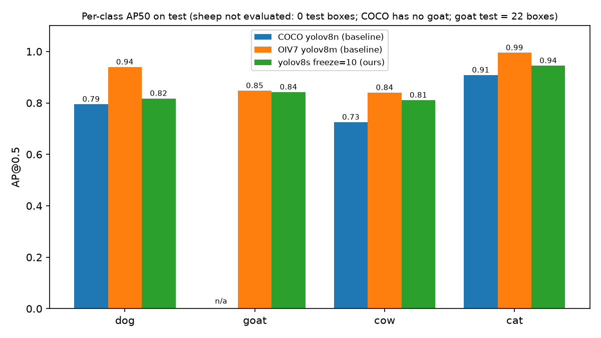

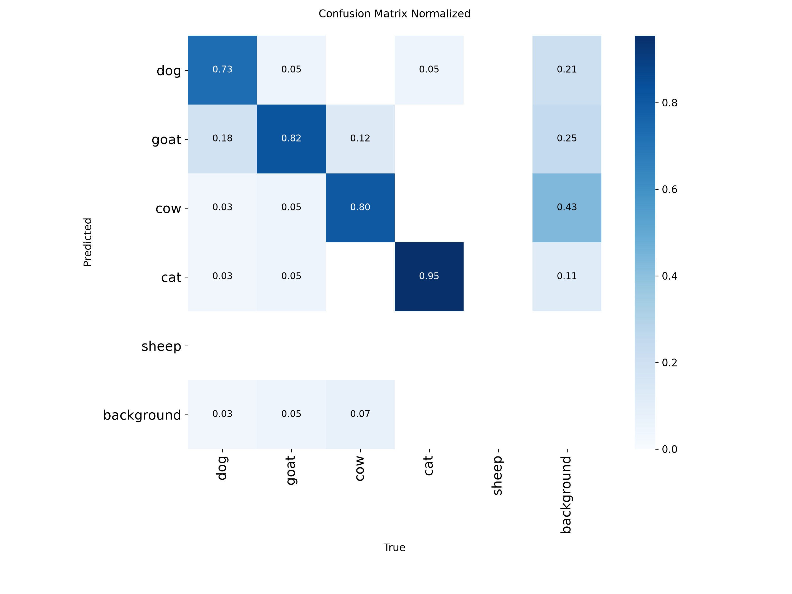

### 4.4 Sheep and goat on test_extra (80 images; dog 4, goat 108, cow 70, sheep 116 boxes)

| Model | mAP50 | sheep AP50 | goat AP50 |
|---|---|---|---|
| COCO `yolov8n` | 0.258 | 0.717 | n/a |
| Open Images `yolov8m-oiv7` | **0.415** | **0.767** | **0.726** |
| Ours v1 | 0.218 | 0.268 | 0.561 |
| **Ours v2** | 0.354 | 0.711 | 0.674 |

Sheep AP50 went from 0.268 (v1) to 0.711 (v2): that is the sheep gap fix. Dog (4 boxes) and cow AP on this set are not meaningful (v2 cow AP50 0.033), so the overall test_extra mAP50 should be read with care.
The very low cow value is reported as measured; we did not investigate its cause.

### 4.5 Honest analysis

- **Fine-tuning did not beat the Open Images baseline.** v2 is above the COCO baseline on test mAP50 (0.842 vs 0.810) and on goat (which COCO cannot detect), but below the Open Images baseline (0.906) on both test sets.
  That baseline probably saw these photos during pretraining, so the gap is likely overstated, but we cannot prove it.
- **v1 vs v2 on the frozen test is a tie.** 0.854 vs 0.842 mAP50 (and 0.577 vs 0.589 mAP50-95) is within noise for 118 boxes. v2 is preferred because it also handles sheep and goat on more data.
- **Overfitting is reduced, not removed** (train class loss 0.38 vs validation 1.02).
- **Training data are not street scenes**: the Mendeley images are mostly farm and nature scenes with one animal each.
- **Test is not Nepal**: expect a drop on night, rain, blur, partly hidden cows behind vehicles and crowded goat herds.

### 4.6 Failure cases

On the 80 test images (confidence at least 0.25, IoU 0.5) the final model made 12 wrong-class predictions, 13 misses and 6 false positives
(`results/failure_cases.md`; the causes below are descriptions of the pictures, not verified explanations).

| Crowded scene: 2 of 4 goats missed | Wrong class: a dog labelled, predicted goat (0.94) |
|---|---|
|  |  |
| **Miss: a cow not detected** | **False positive: a cow (0.70) where nothing is labelled** |
|  |  |

### 4.7 Sample detections of the final model

Produced with `src/demo.py` on images from the test and test_extra sets (confidence 0.25).

| dog (test) | goat (test) | cow (test) |
|---|---|---|
| 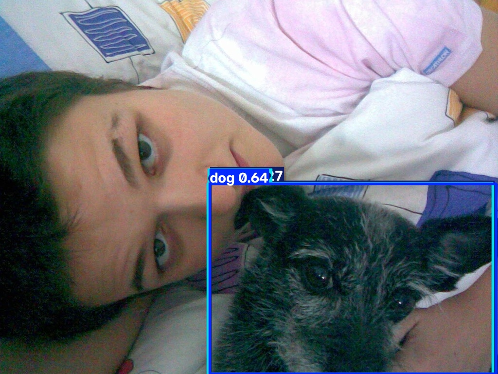 | 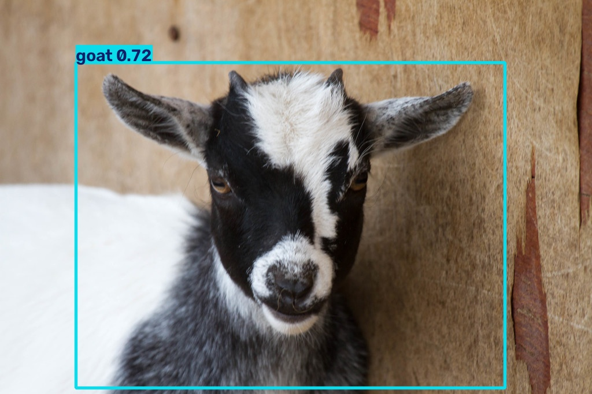 |  |
| **cat (test)** | **goat (test_extra)** | **sheep (test_extra)** |
| 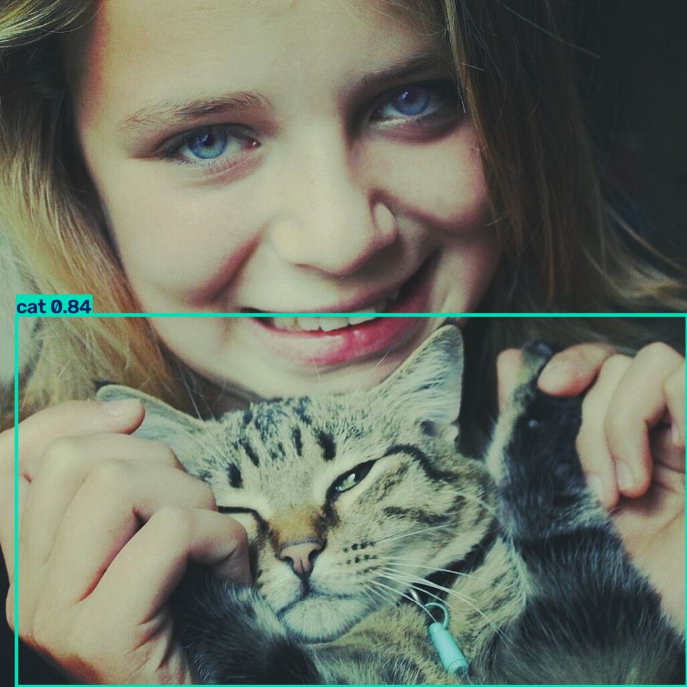 | 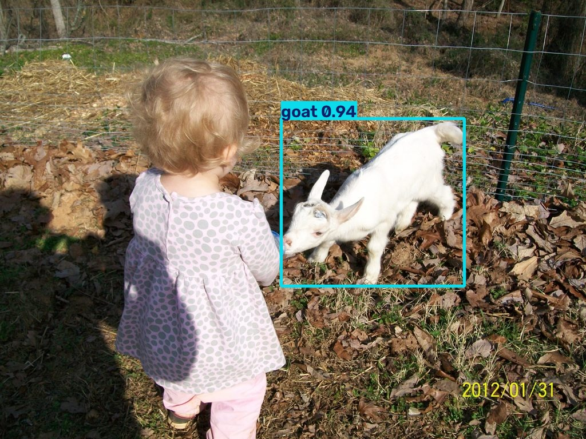 | 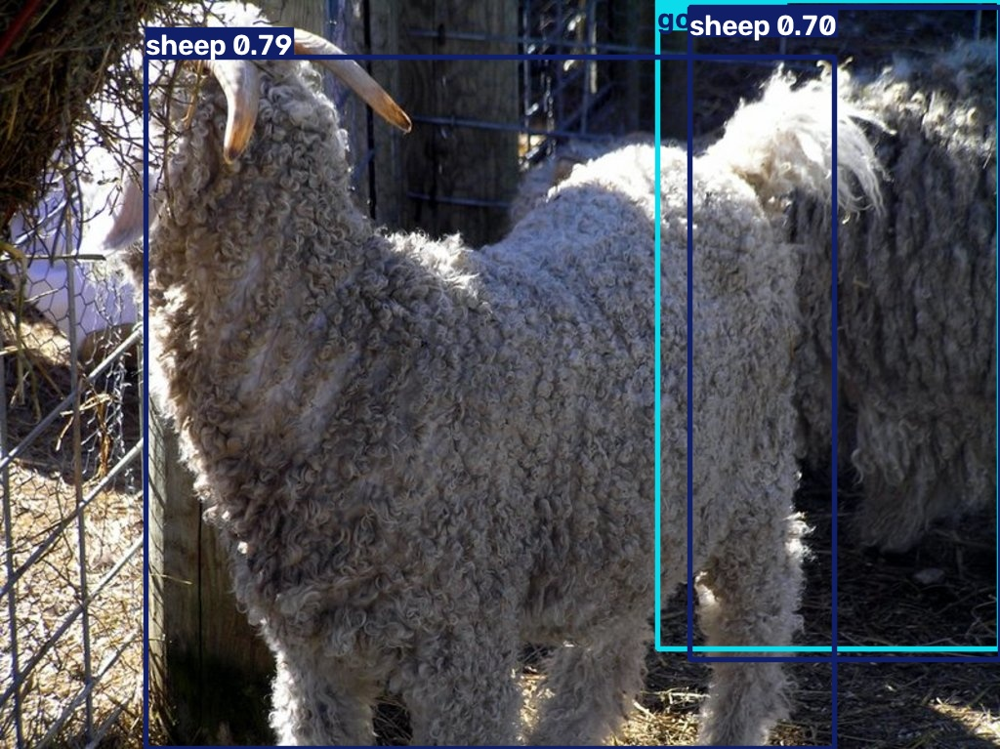 |

---

## 5. The surveillance website

`python web/app.py` serves a local Flask site (`web/`), listening on 127.0.0.1:5055 only. Details and limits: [`web/README.md`](web/README.md).

### 5.1 Architecture

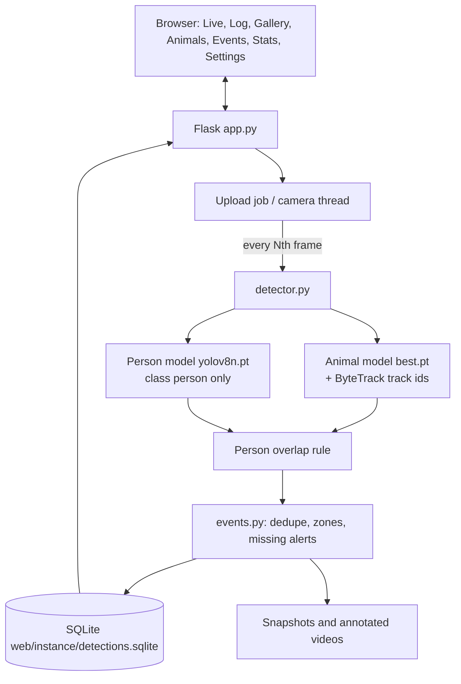

### 5.2 The person-versus-animal rule

People are detected by a second model, COCO `yolov8n`, using only its `person` class (confidence at least 0.25). A person is **never** logged as an animal. An animal box is dropped
when a person is present and the box (a) has its centre inside a person box, (b) overlaps a person box with IoU above 0.3, or (c) has more than 70% of its area inside a person box;
this stops a person being logged as a cat or dog. A very confident animal box (confidence at least 0.8) is kept anyway, so a cow standing next to a person is still a cow.
Animals must reach confidence 0.5 (adjustable per class). All thresholds are in `web/config.json` and can be changed on the Live page.

### 5.3 Tracking, logging, zones and alerts

- **ByteTrack** (built into Ultralytics) gives each animal a track number within one upload or camera session; numbers restart each session. A track number is **not** an identity: an animal that leaves
  the view can return with a new number.
- **Logging.** Detection runs every 5th frame of an upload and every 3rd of a live camera. Each (source, class) is logged at most once per 10 seconds, and each new track is logged once when it first appears.
  Every logged row stores a snapshot with the boxes drawn.
- **Schema** (`web/db.py`, SQLite): `detections` (time `ts`, `kind` animal or person, class, confidence, source, clip time, box `x1 y1 x2 y2`, snapshot, track id),
  `tracks` (per source and track: class, first and last time, frames, snapshot, alerted), `sources`, `zones` (name and a polygon in 0-1 frame coordinates), `alerts` (time, source, track, class, last seen, message, kind `missing` or `zone`).
- **Zones.** Draw a rectangle or polygon on a running camera feed. An alert fires when the *centre* of a tracked animal's box enters a zone (once per entry; an untracked animal at most once a minute per zone). Uploads raise no zone alerts.
- **Lost-animal ("missing") alerts.** A track is *present* if seen within 30 s (`presence_seconds`). If `missing_alert_minutes` is above 0, a camera that is running raises one alert when a tracked animal has not been seen for that long, with a banner on the Live page and a row in the alerts list.
- **Extras:** event grouping (repeated detections merged by a time gap), CSV export, a printable report, demo data clearly marked as invented, light and dark theme.

### 5.4 Screenshots

| Live view with detections | Detection log |
|---|---|
| 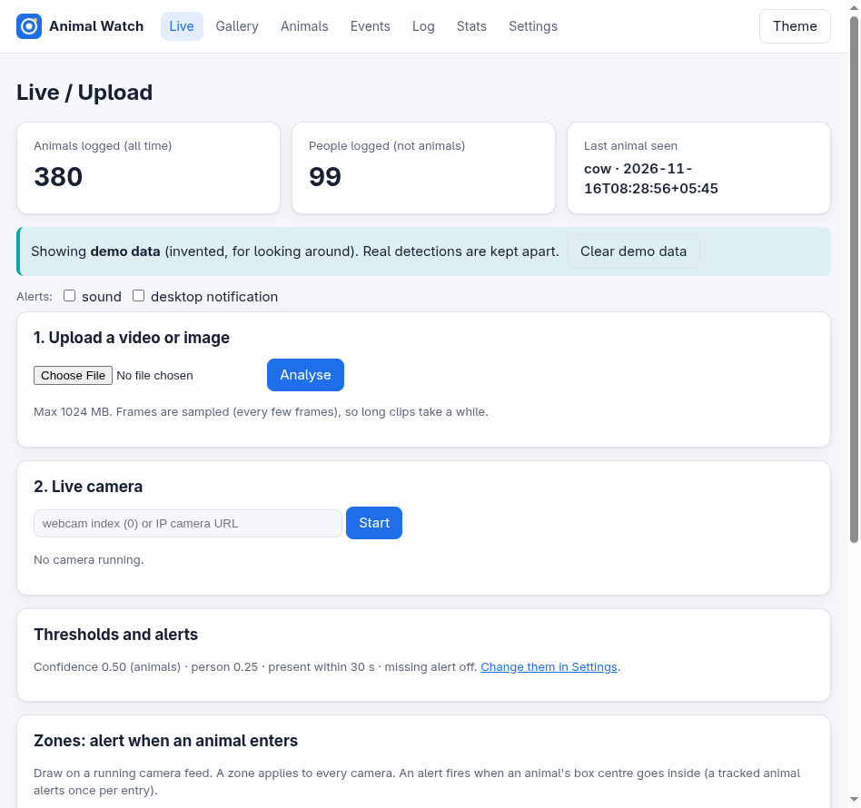 | 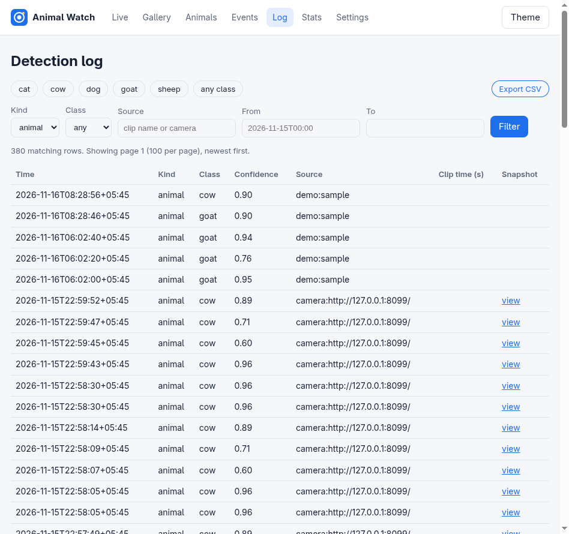 |
| **Statistics** | **Snapshot gallery** |
| 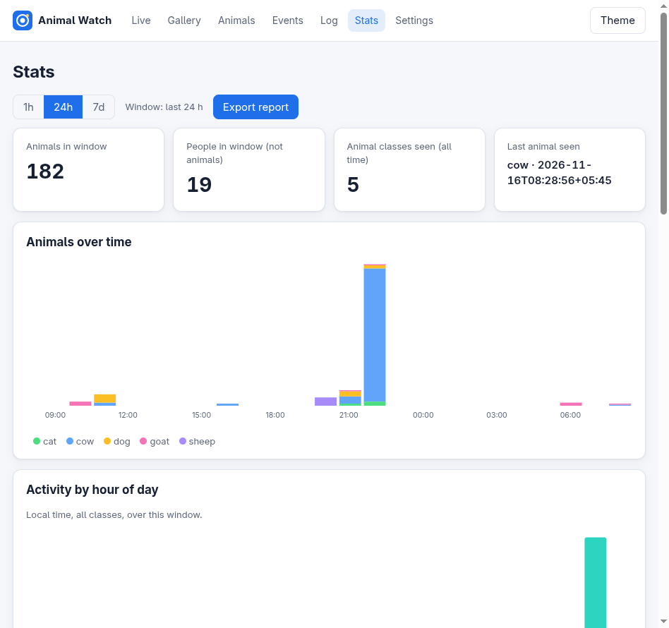 | 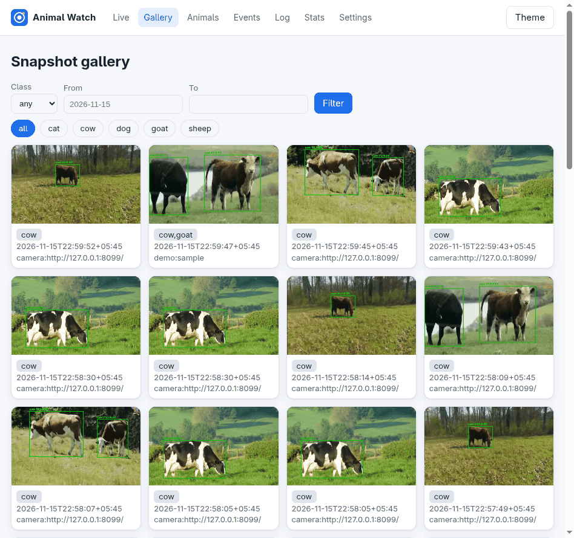 |
| **Tracked animals (present / missing)** | **Zones** |
| 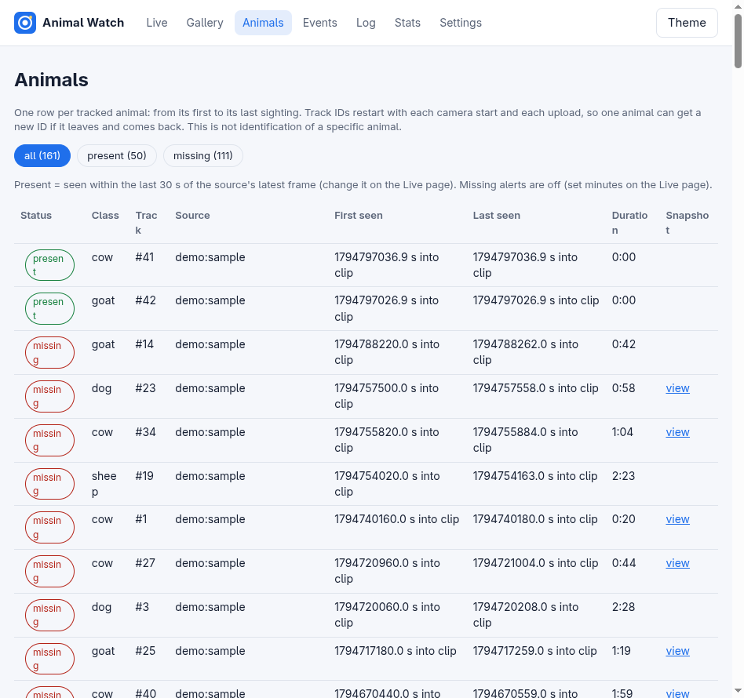 | 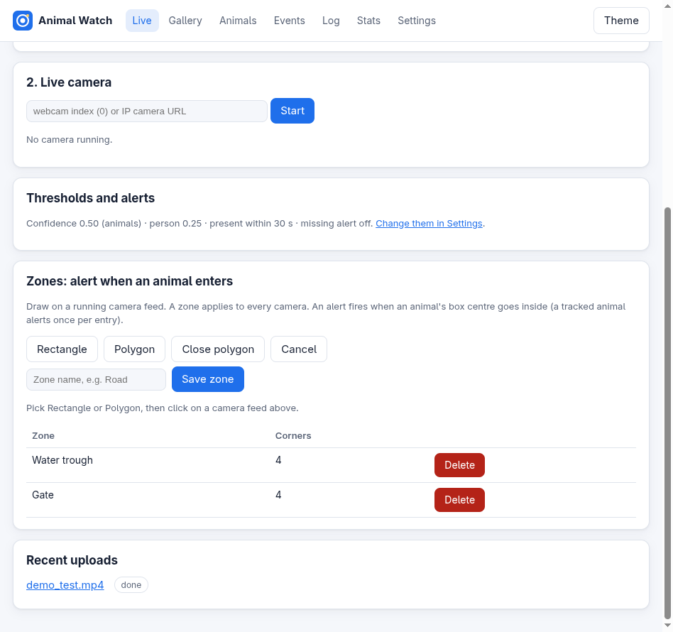 |

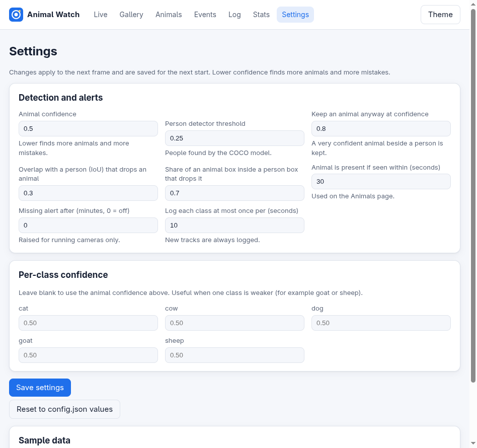

---

## 6. Ethics, limitations and future work

**Limitations**

- Trained and tested on public photos, **not on Nepal street footage**; accuracy in the field is unknown.
- Goat and sheep are the weakest classes (little hand-labelled data, similar appearance); the cow AP on test_extra is very low.
- 55% of the v1 training images (and part of v2) have boxes generated by a detector, not drawn by people.
- The Open Images baseline is probably inflated, and the test sets are small (118 boxes in `test`), so small differences are noise.
- Track numbers are not identities; the system cannot say that *this* goat is the one that went missing.
- Evaluation numbers come from one seed on one machine.

**Ethics and privacy**

- Cameras that watch streets also capture people. The website detects people only to keep them out of the animal log; it stores snapshots of animals and, when a person is in the frame, may store
  that person in the snapshot. Anyone deploying it needs the consent and legal basis the local rules require, should avoid faces and licence plates in anything they publish, and should delete old snapshots.
- The site is local and unauthenticated by design (127.0.0.1). It is **not** safe to expose to a network as it is.
- This is not a safety system. Do not use detections for decisions that affect animals or people without human review. False alerts (and missed animals) are expected.
- All data used here are public and carry their own licences (Section 9); none is redistributed.

**Future work**

1. Photograph and label a Nepal street test set (the project plan asks for 150 to 300 photos per class across places, times of day and distances) and report accuracy on it first.
2. Replace auto-generated Mendeley boxes with hand-checked ones; evaluate the whole-frame variant B on the test sets.
3. More goat, sheep and cat data and night images; try larger input sizes for small animals.
4. Multi-seed runs and confidence intervals; compare `yolov8s` with other detectors.
5. Re-identification so a track survives leaving the frame; multiple cameras; optional physical alert output (siren, webhook).

---

## 7. Reproducing everything

### 7.1 Get the data (not in the repo)

The images are too large for git and carry their own licences, so `data/raw/` and `data/dataset/` are git-ignored. Rebuild order (repo root, environment active):

1. **Open Images, 4 classes** to `data/raw/openimages_yolo/`: `python data/dataset_multi.py --n 400` (expects the metadata that FiftyOne downloads; see the script header).
2. **Open Images goat/sheep** to `data/raw/openimages_goat_sheep/`: reference scripts `docs/data_rebuild/oi_dl.py` and `oi_conv.py` (they need `fiftyone`, which needs MongoDB, so it is not in `requirements.txt`).
3. **Mendeley herbivores (5 classes)**: download by DOI 10.17632/fwm6z9tv3f.1 and unzip to `data/raw/mendeley_herbivores5/`.
4. **Mendeley street animals**: DOI 10.17632/fk29shm2kn.1, class folders under `data/raw/mendeley/`, then `python data/mendeley_autolabel.py --n 300`.
5. **Split and merge**: `python src/data/split_dataset.py ...` (v1, 70/20/10 by group), `python src/data/merge_v2.py --write` (v2), `python src/data/make_nowf_list.py` (variant B list).
   Validate with `python src/data/validate_dataset.py --root data/dataset` and look at labels with `python data/check_labels.py`.

Only part of this is scripted end to end, and the original `split_manifest.csv` is not in git, so a rebuild can differ slightly from our splits (metrics then differ a little).
If you only want to *use* the model you need none of it.

### 7.2 Baselines, training, evaluation, plots

```bash
python src/baseline_eval.py                                   # COCO + Open Images baselines -> results/baseline.csv
python src/train.py --model yolov8s.pt --freeze 10 --epochs 80 --batch 8 --workers 2 --name my_run
python src/evaluate.py --weights results/weights/my_run.pt --data data/dataset/data.yaml \
    --out results/my_run.csv --comparison results/my_comparison.csv   # own file names: the tracked CSVs stay untouched
python src/make_plots.py --weights results/weights/best.pt   # figures in results/figures/
```

`src/train.py` never overwrites `best.pt`: compare new models on the validation split, then promote by hand. Notebook `02_train_model.ipynb` does the same step by step (about 30 minutes for the full recipe on a 6 GB laptop GPU).
`baseline_eval.py` and `make_plots.py` rewrite `results/baseline.csv` and `results/figures/*`; copy the results folder first if you want to keep the originals.

**Safety tip (Linux):** run heavy jobs under a memory cap so a mistake cannot freeze the computer:

```bash
systemd-run --user --scope -p MemoryMax=15G -p MemorySwapMax=0 python src/train.py --batch 8 --workers 2 ...
```

### 7.3 Tests

```bash
python -m unittest web/test_rules.py web/test_tracks.py web/test_features.py     # no model or Flask needed
```

---

## 8. Repository layout

```
README.md  LICENSE  requirements.txt  requirements-lock.txt  PROJECT_PLAN.md
src/        train.py  evaluate.py  baseline_eval.py  demo.py  make_plots.py
src/data/   split, merge, validate, auto-label and list-building scripts
data/       SOURCES.md, label_map.md, check_labels.py ...; raw/ and dataset/ are NOT in git
notebooks/  00-05 .ipynb walk-throughs (README.md has the run order)
web/        Flask site: app.py detector.py db.py events.py templates/ static/ config.json
results/    comparison*.csv, experiments.csv, RESULTS_NOTES.md, failure_cases.md, figures/, weights/best.pt
docs/       presentation.md, qa.md, images/ (README figures and screenshots), data_rebuild/
```

Only `results/weights/best.pt` (the final model) is tracked among the weight files; all other `*.pt` are git-ignored. `yolov8n.pt` (person detector, COCO baseline) downloads automatically on first use; `yolov8m-oiv7.pt`
(Open Images baseline, needed only for `baseline_eval.py` and notebook 01) is not tracked: place it in the repo root (Ultralytics publishes it with the YOLOv8 assets).

---

## 9. Licence and credits

- **Code:** GNU **AGPL-3.0** (`LICENSE`), because the project builds on [Ultralytics YOLOv8](https://github.com/ultralytics/ultralytics) (AGPL-3.0). If you run a modified version as a network service you must offer its source
  to the users. Ultralytics also sells an enterprise licence.
- **Data keep their own licences:** Open Images annotations CC BY 4.0, images CC BY 2.0 (per-image credit in the Open Images metadata); both Mendeley sets CC BY 4.0. Credit the data authors if you reuse the data.
- **Credits:** Ultralytics YOLOv8; Google Open Images V7; the Mendeley Data authors of the herbivore and street-animal sets (`data/SOURCES.md`); PyTorch, OpenCV, Flask. Website ideas came from the public projects in Section 2.5 (ideas only, no code copied).
- Built as a student computer-vision project, with AI agent assistants for coding and documentation.

To cite this project: *Animal Detection on Streets (YOLOv8 fine-tuned on dog, goat, cow, cat, sheep), 2026, https://github.com/Suchit-Aryal/Animal-Detector*.

---

## 10. References

1. Jocher, G., Chaurasia, A., Qiu, J. *Ultralytics YOLOv8* (software). <https://github.com/ultralytics/ultralytics>
2. Redmon, J., Divvala, S., Girshick, R., Farhadi, A. "You Only Look Once: Unified, Real-Time Object Detection." CVPR 2016.
3. Zhang, Y. et al. "ByteTrack: Multi-Object Tracking by Associating Every Detection Box." ECCV 2022.
4. Kuznetsova, A. et al. "The Open Images Dataset V4." International Journal of Computer Vision, 2020.
5. Lin, T.-Y. et al. "Microsoft COCO: Common Objects in Context." ECCV 2014.
6. Zheng, Z. et al. "Distance-IoU Loss: Faster and Better Learning for Bounding Box Regression" (the CIoU loss). AAAI 2020.
7. Li, X. et al. "Generalized Focal Loss: Learning Qualified and Distributed Bounding Boxes for Dense Object Detection" (distribution focal loss). NeurIPS 2020.
8. Feng, C. et al. "TOOD: Task-aligned One-stage Object Detection." ICCV 2021.
9. Yosinski, J., Clune, J., Bengio, Y., Lipson, H. "How transferable are features in deep neural networks?" NeurIPS 2014.
10. Mendeley Data: "Annotated Object Detection Dataset of Five Herbivorous Animal Classes", DOI 10.17632/fwm6z9tv3f.1 (CC BY 4.0).
11. Mendeley Data: "Labelled dataset of animal images for detecting their presence on streets", DOI 10.17632/fk29shm2kn.1 (CC BY 4.0).
12. "Evaluating YOLO architectures for detecting road-killed endangered Brazilian animals." Scientific Reports, 2024.
13. Cow crossing detection alert system, IJTech (as listed in `PROJECT_PLAN.md` section 4).
14. Project repositories reviewed for website ideas: `results/web_research.md` (Frigate, Viseron, ZoneMinder, dvr-yolov8-detection, OpenCV-Animal-Detector, wild-watch and others).
