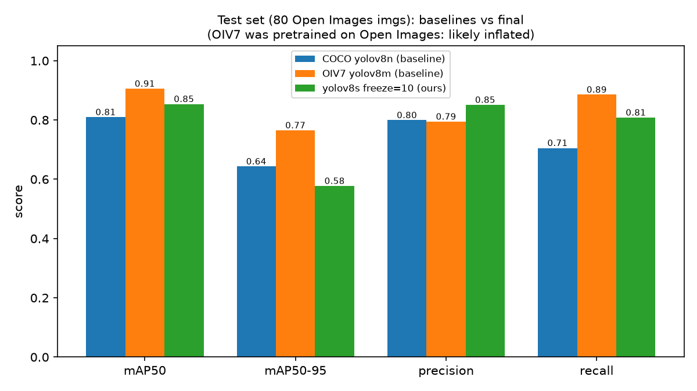

# Animal Detection on Streets

A computer vision system that finds **dogs, goats, cows, cats and sheep** in photos, videos and live camera feeds.
It is built for street scenes in Nepal, where stray and free-roaming animals are a daily sight. A fine-tuned YOLOv8 detector
finds the animals, people are detected separately and are never logged as animals, and a small Flask website keeps a
**timestamped log** of every sighting (class, confidence, source, snapshot) and can raise a **lost-animal alert**
when a tracked animal has not been seen for a set time.



## Features

- Detects 5 classes: `0 dog, 1 goat, 2 cow, 3 cat, 4 sheep` (YOLOv8s fine-tuned with the first 10 layers frozen).
- Works on an image, a video file, an IP camera URL or a webcam.
- Website (`web/`): upload or live view, detection log with CSV export, gallery, events, statistics, per-animal tracking
  (present / missing), alerts for animals not seen for N minutes, drawable zones, light/dark theme.
- People are detected with the COCO `person` class and kept out of the animal log.
- Five notebooks that walk through the whole pipeline (data, baselines, training, evaluation, demo, website).
- Every number below comes from a script in this repo (`src/`) and a CSV in `results/`.

## Results

Test set: 80 held-out **Open Images** photos (118 boxes). Precision and recall come from the Ultralytics validator (confidence 0.001, NMS IoU 0.7); FPS is the time of `model.predict` per image on an
RTX 4050 laptop GPU (yours will differ). Source: `results/comparison.csv`.

| Model | mAP50 | mAP50-95 | Precision | Recall | FPS |
|---|---|---|---|---|---|
| COCO `yolov8n` (pretrained, no goat class) | 0.810 | 0.643 | 0.799 | 0.705 | 115 |
| Open Images `yolov8m-oiv7` (pretrained) | 0.906 | 0.765 | 0.794 | 0.885 | 56 |
| Ours v1 (`yolov8s`, freeze=10) | 0.854 | 0.577 | 0.851 | 0.808 | 78 |
| **Ours v2 = `results/weights/best.pt`** | 0.842 | 0.589 | 0.803 | 0.763 | 98 |

Second test set `test_extra` (80 Open Images photos with 108 goat, 116 sheep, 70 cow and only 4 dog boxes; `results/comparison_test_extra.csv`):

| Model | mAP50 | sheep AP50 | goat AP50 |
|---|---|---|---|
| COCO `yolov8n` | 0.258 | 0.717 | no goat class |
| Open Images `yolov8m-oiv7` | 0.415 | 0.767 | 0.726 |
| Ours v1 | 0.218 | 0.268 | 0.561 |
| **Ours v2** | 0.354 | 0.711 | 0.674 |

**Read these numbers honestly:**

- **The test set is not Nepal data.** It is interim: Open Images photos with human-drawn boxes. A test set of our own labelled Nepal street photos is still to be made.
- **The Open Images baseline is probably inflated.** It was pretrained on Open Images, so it may have seen these test photos. Do not read "ours is below the baseline" as the whole story.
- **Sheep are evaluated only on `test_extra`.** The frozen `test` split has no sheep; `test_extra` has dog and cow counts too small for a reliable AP (dog 4 boxes).
- With 118 test boxes, differences of about 0.01 mAP50 (v1 vs v2) are within noise.
- The model still overfits (train class loss 0.38, validation 1.02). 55% of the first training set (Mendeley street photos) has boxes generated by a detector, not drawn by people.
- More detail: `results/RESULTS_NOTES.md`, failure examples: `results/failure_cases.md`.

## Quick start

You need Python **3.11**, about 3 GB of disk and (optional) an NVIDIA GPU. Run everything from the repo root.

### 1. Get the code and create an environment

```bash
git clone <this repo's URL>
cd <repo folder>

# Option A: conda (Linux / macOS / Windows)
conda create -n animal-det python=3.11 -y
conda activate animal-det

# Option B: venv
python3.11 -m venv .venv
source .venv/bin/activate           # Linux / macOS
.venv\Scripts\activate              # Windows (cmd or PowerShell)
```

### 2. Install the packages

GPU or CPU matters for PyTorch. Install PyTorch **first**, choosing your CUDA version (or CPU) on <https://pytorch.org/get-started/locally/>, for example:

```bash
pip install torch torchvision --index-url https://download.pytorch.org/whl/cpu      # CPU only
# or pick the cu12x line that matches your driver for an NVIDIA GPU
```

Then:

```bash
pip install -r requirements.txt
```

`requirements.txt` lists only the direct dependencies. `requirements-lock.txt` is the full frozen environment of the original
Linux + CUDA machine; it is for reference and will not install elsewhere as it is. If you skip the PyTorch step, `ultralytics`
installs a default PyTorch for you (on Linux that is a large CUDA build).

### 3. Run the model on an image or video

The trained weights `results/weights/best.pt` (22 MB) are in the repo. No dataset is needed for this.

```bash
python src/demo.py --source path/to/street.jpg      # writes results/figures/<name>_annotated.jpg
python src/demo.py --source path/to/street.mp4      # writes an annotated .mp4
python src/demo.py --source 0 --max-frames 300      # webcam
# add --device cpu if you have no GPU, --conf 0.4 for fewer, surer boxes
```

### 4. Run the website

```bash
python web/app.py
```

Open <http://127.0.0.1:5055/> (it only listens on your own computer). The first start downloads `yolov8n.pt` (the person detector) automatically.
For video upload playback in the browser, install `ffmpeg` (optional). User guide and limits: `web/README.md`.

### 5. Run the notebooks

```bash
python -m ipykernel install --user --name animal-det --display-name "Python (animal-det)"
jupyter lab
```

Open the notebooks in `notebooks/` and pick the **animal-det** kernel. Each notebook runs a fast demo by default (about 10 images, or
1 epoch); set `FULL_RUN = True` in its first parameter cell for the real run. Notebooks 01-04 need the dataset for the test images
(see "Getting the data"); `04` and the website work with just the weights and any image. Run order and descriptions: `notebooks/README.md`.

## Getting the data (not in the repo)

The images are too large for git and carry their own licences, so `data/raw/` and `data/dataset/` are git-ignored.
Every source, its licence, how it was used and the counts are in **`data/SOURCES.md`**. Short version:

| Source | Licence | Access | Used for |
|---|---|---|---|
| Open Images V7 (Dog, Goat, Cattle, Cat, Sheep) | annotations CC BY 4.0, images CC BY 2.0 | public, no login | train / val / test / test_extra, human boxes |
| Mendeley "Annotated Object Detection Dataset of Five Herbivorous Animal Classes" (DOI 10.17632/fwm6z9tv3f.1) | CC BY 4.0 | public download | train only |
| Mendeley street animals (class folders, no boxes) | see data/SOURCES.md | public download | train only, boxes auto-generated |
| Roboflow Universe sets (stray dogs, goats, cattle, stray cats; list in `data/SOURCES.md`) | per page, mostly CC BY 4.0 | **optional, needs a Roboflow login** | not used so far |

Rebuild steps, in order (all from the repo root, env active). Parts of this were done by hand, and the exact scripts are noted:

1. **Open Images, 4 classes** -> `data/raw/openimages_yolo/`: `python data/dataset_multi.py --n 400` (it expects the Open Images metadata that FiftyOne downloads; see the script header).
2. **Open Images goat/sheep** -> `data/raw/openimages_goat_sheep/`: reference scripts `docs/data_rebuild/oi_dl.py` and `oi_conv.py` (need `fiftyone`, which needs MongoDB; not in `requirements.txt`).
3. **Mendeley herbivores (5 classes)**: download from the DOI above and unzip to `data/raw/mendeley_herbivores5/`.
4. **Mendeley street animals**: unzip into class folders under `data/raw/mendeley/`, then `python data/mendeley_autolabel.py --n 300` (model-generated boxes, train only).
5. **Split and merge**: `python src/data/split_dataset.py ...` builds v1 (70/20/10 by group); `python src/data/merge_v2.py --write` adds the v2 data, and `python src/data/make_nowf_list.py` builds the optional "no whole-frame boxes" list. Check with `python src/data/validate_dataset.py` and `python data/check_labels.py`.

Notebook `notebooks/00_data_pipeline.ipynb` explains these steps. Counts after the merge: train 2,993 / val 634 / test 80 images (plus `test_extra` 80).
The exact original split is recorded in `data/dataset/split_manifest.csv` on the original machine only; a rebuild from the sources can differ in detail, so metrics can differ slightly. If you only want to *use* the model, you do not need any of this.

## Retrain

Fine-tune (the recipe behind `best.pt`: `yolov8s.pt`, `freeze=10`, 80 epochs, batch 8, seed 0, config in `results/weights/` after a run):

```bash
python src/train.py --model yolov8s.pt --freeze 10 --epochs 80 --batch 8 --workers 2 --name my_run
python src/evaluate.py --weights results/weights/my_run.pt --data data/dataset/data.yaml \
    --out results/my_run.csv --comparison results/my_comparison.csv      # test metrics (own file names, so the tracked CSVs stay untouched)
```

`src/train.py` copies the best epoch to `results/weights/<name>.pt` and never overwrites `best.pt`; promote a model by hand only after
comparing it on the validation split (not the test split). Notebook `02_train_model.ipynb` does the same step by step. A full run takes
about 30 minutes on a 6 GB laptop GPU.

**Safety tip (Linux):** run heavy jobs under a memory cap so a mistake cannot freeze the computer:

```bash
systemd-run --user --scope -p MemoryMax=15G -p MemorySwapMax=0 python src/train.py --batch 8 --workers 2 ...
```

## Project structure

```
README.md  LICENSE  requirements.txt  requirements-lock.txt  PROJECT_PLAN.md
src/        train.py  evaluate.py  baseline_eval.py  demo.py  make_plots.py   models: train / test / run
src/data/   dataset building and checking scripts (split, merge, validate, auto-label)
data/       SOURCES.md and label scripts; raw/ and dataset/ are NOT in git (see "Getting the data")
notebooks/  00-05 .ipynb walk-throughs (README.md has the run order)
web/        Flask surveillance site (app.py, detector.py, db.py, events.py, templates/, static/)
results/    comparison*.csv, experiments.csv, figures/, RESULTS_NOTES.md, weights/best.pt (tracked)
docs/       presentation outline, Q&A, data_rebuild/ reference scripts
```

Model files: only `results/weights/best.pt` (the final model) is tracked in git. All other `*.pt` files are ignored.
`yolov8n.pt` (person detector, COCO baseline) downloads itself on first use; `yolov8m-oiv7.pt` (Open Images baseline) is only needed for
`src/baseline_eval.py` and notebook 01 and downloads the same way on first use.

## Limitations

- Trained and tested on public photos, not on Nepal street footage; expect lower accuracy on night, rain, motion blur and crowded herds.
- Goat and sheep are the weakest classes (little hand-labelled data); dog and cat are well covered.
- Track numbers on the website are not identities: an animal that leaves the view can come back with a new number.
- Not a safety system. Do not use it for decisions that affect animals or people without human review.

## Licence and credits

- This project is released under the **GNU AGPL-3.0** (`LICENSE`), because it builds on [Ultralytics YOLOv8](https://github.com/ultralytics/ultralytics) (AGPL-3.0).
  If you run a modified version as a network service you must offer its source to the users. Ultralytics also sells an enterprise licence.
- Datasets keep their own licences: Open Images annotations CC BY 4.0, images CC BY 2.0 (per-image credit in the Open Images metadata);
  the Mendeley herbivore set CC BY 4.0. Credit the dataset authors if you reuse the data; none of it is redistributed here.
- Credits: Ultralytics YOLOv8; Google Open Images V7; the Mendeley Data authors of the herbivore and street-animal sets (see `data/SOURCES.md`);
  PyTorch, OpenCV, Flask. Several ideas for the website came from public surveillance projects reviewed in `results/web_research.md` (features only, no code copied).
- Built as a student computer vision project, with AI agent assistants for coding and documentation.

To cite this project: *Animal Detection on Streets (YOLOv8 fine-tuned on dog, goat, cow, cat, sheep), 2026, <repo URL>*.
