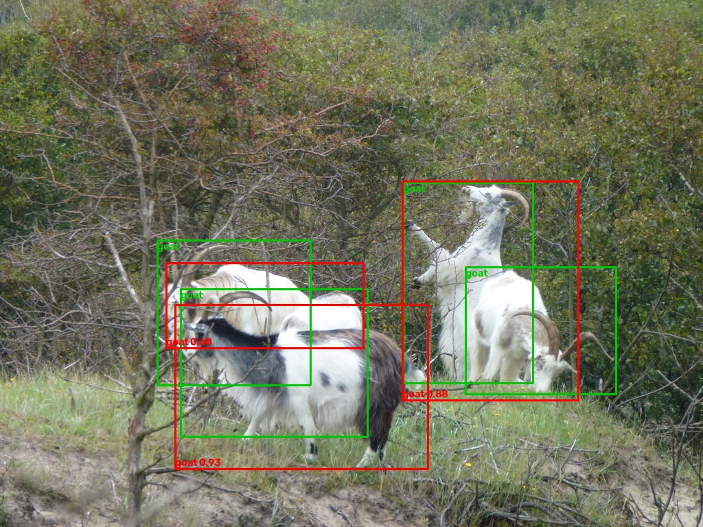
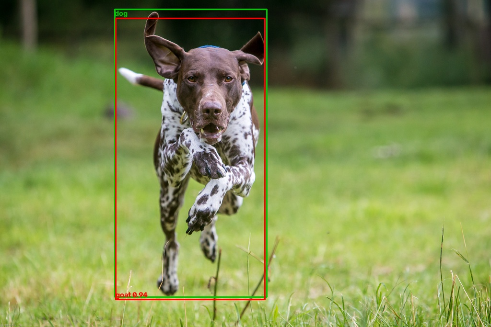
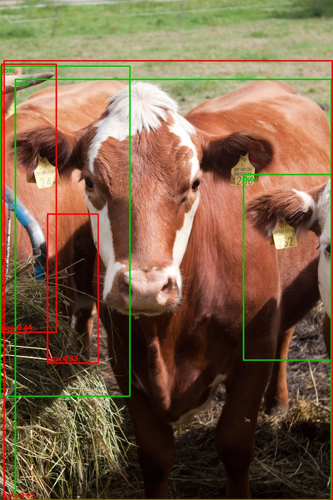
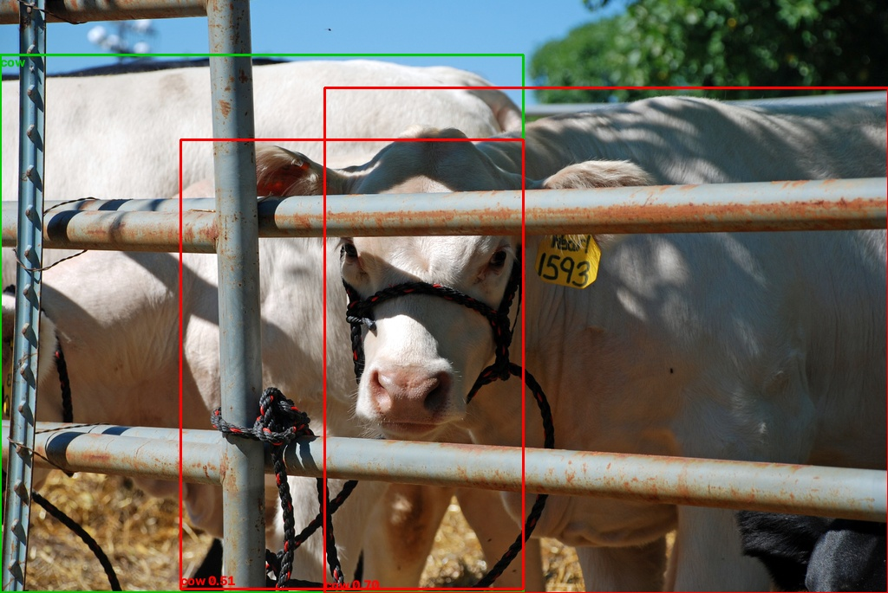

# Failure cases (test set, conf >= 0.25, IoU 0.5)
Model: results/weights/best.pt. Green = ground truth, red = prediction. Counts of events over all 80 test images: wrong_class 12, miss 13, false_positive 6, group 1.
Explanations list what the data shows; causes are not verified.

## group

openimages_yolo__067b3591e94386b1.jpg: crowded scene: 4 labelled animals, 2 error(s): goat not detected (conf>=0.25); goat not detected (conf>=0.25).

## wrong_class

openimages_yolo__cfc793ef222599d4.jpg: dog labelled, predicted goat (0.94).

## miss

openimages_yolo__06f4e6d2fd724c62.jpg: cow not detected (conf>=0.25).

## false_positive

openimages_yolo__f497432e27d0c450.jpg: predicted cow (0.70) where there is no labelled animal.
